实验教材：

1)  [Apollo开放平台文档 - 必备软件安装指南](https://developer.apollo.auto/Apollo-Homepage-Document/Apollo_Doc_CN_6_0/%E5%AE%89%E8%A3%85%E8%AF%B4%E6%98%8E/%E5%BF%85%E5%A4%87%E8%BD%AF%E4%BB%B6%E5%AE%89%E8%A3%85%E6%8C%87%E5%8D%97/#%E6%AD%A5%E9%AA%A4%E5%9B%9B%EF%BC%9A%E5%AE%89%E8%A3%85-nvidia-container-toolkit) 6.0

2)  [Apollo开放平台文档 - 必备软件安装指南](https://apollo.baidu.com/community/Apollo-Homepage-Document/Apollo_Doc_CN_8_0?doc=%2F%25E5%25AE%2589%25E8%25A3%2585%25E8%25AF%25B4%25E6%2598%258E%2F%25E8%25BD%25AF%25E4%25BB%25B6%25E5%258C%2585%25E5%25AE%2589%25E8%25A3%2585%2F%25E8%25BD%25AF%25E4%25BB%25B6) 8.0

实验环境：

1)  EVO VIII D:\Mitsubishi\EVO_VIII

2)  EVO X D:\Mitsubishi\EVO_X

实验内容及操作步骤：

**一、6.0**

1)  安装 Ubuntu Linux

``` bash
sudo apt-get update
sudo apt-get upgrade
```


2)  安装 NVIDIA GPU 驱动

``` bash
sudo apt-add-repository multiverse
sudo apt-get install nvidia-driver-455
```

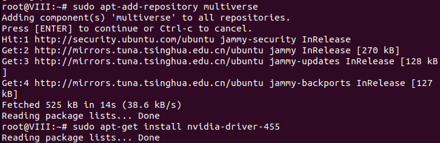

``` bash
nvidia-smi
```

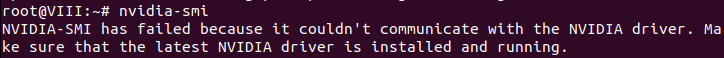

3)  安装 Docker Engine

``` bash
wget http://apollo-pkg-beta.bj.bcebos.com/docker_install.sh
bash docker_install.sh
```

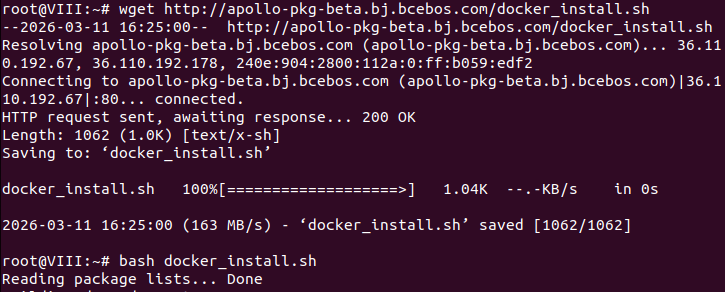

4)  安装 NVIDIA Container Toolkit

``` bash
sudo apt-key add /home/evo/Desktop/gpgkey
cat /home/evo/Desktop/nvidia-docker.list | sudo tee /etc/apt/sources.list.d/nvidia-docker.list
sudo apt-get -y update
```

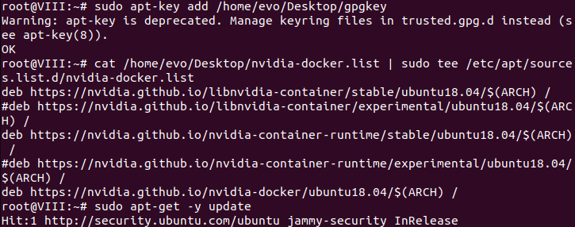

``` bash
sudo apt-get install nvidia-docker2
```

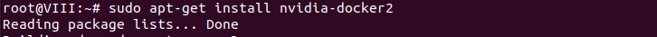

``` bash
sudo systemctl restart docker
sudo systemctl status docker
```

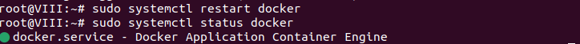

5)  安装 Apollo

``` bash
cd /home/evo/Desktop/apollo-master/;bash docker/scripts/dev_start.sh
```

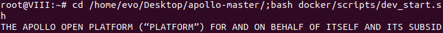

``` bash
bash docker/scripts/dev_into.sh
./apollo.sh build
```

**二、8.0**

1)  安装Ubuntu Linux与Docker Engine

``` bash
sudo apt-get update
sudo apt-get upgrade
```


``` bash
wget http://apollo-pkg-beta.bj.bcebos.com/docker_install.sh
bash docker_install.sh
```

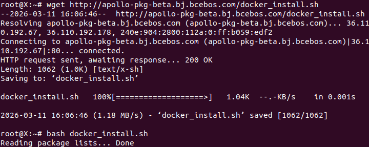

2)  安装 Apollo 环境管理工具

``` bash
sudo bash -c "echo 'deb https://apollo-pkg-beta.cdn.bcebos.com/neo/beta bionic main' >> /etc/apt/sources.list"
wget -O - https://apollo-pkg-beta.cdn.bcebos.com/neo/beta/key/deb.gpg.key | sudo apt-key add -
sudo apt update
```

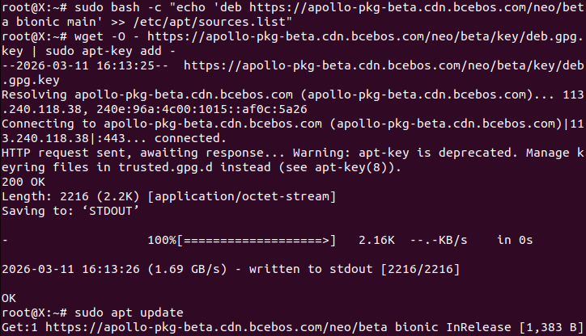

``` bash
sudo apt install apollo-neo-env-manager-dev
aem -h
```

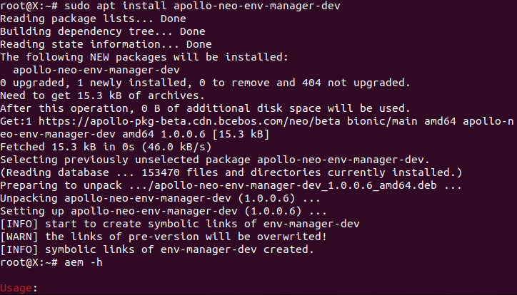

3)  创建和进入 Apollo 环境容器

``` bash
cd /home/evo/Desktop;mkdir application-demo;cd application-demo;aem start
```

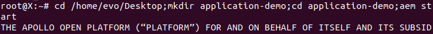

``` bash
aem enter
aem init
```

实

验成绩
