实验教材：

[Ubuntu22上安装fastDDS环境](https://blog.csdn.net/u012739527/article/details/124687387)

1)  [编译FastRTPS跑通FastRTPS](https://fast-dds.docs.eprosima.com/en/2.14.x/installation/binaries/binaries_linux.html)（X）

2)  [安装Java](https://blog.csdn.net/snowdream86/article/details/106160551)与[Gradle](https://blog.csdn.net/qq_23025319/article/details/137429563)

3)  [升级cmake](https://blog.csdn.net/weixin_43907136/article/details/127569449)与[Asio](https://blog.csdn.net/SMILY12138/article/details/130348448)

[HelloWorld示例程序编译和运行](https://blog.csdn.net/u012739527/article/details/124705821)

[CyberRT 剖析文档 - 飞书云文档](https://my.feishu.cn/docx/ToixddPS6oCXqbxmJpjcL5ntnHb)

实验环境：EVO IX D:\Mitsubishi\EVO_IX

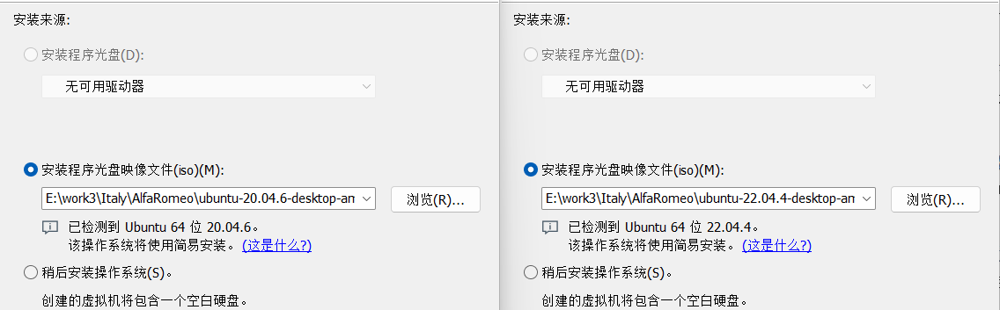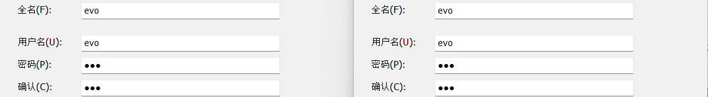

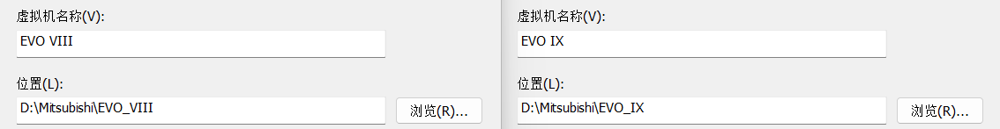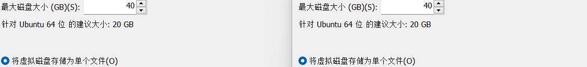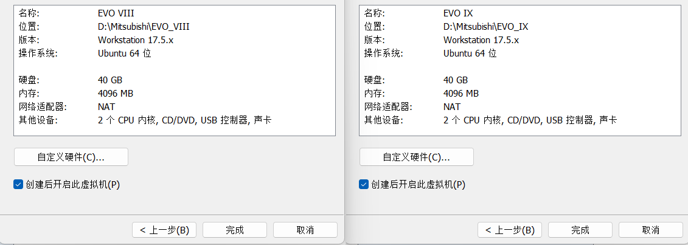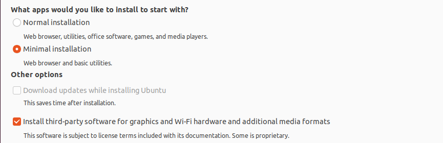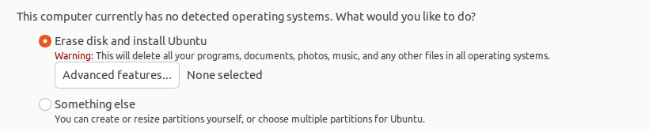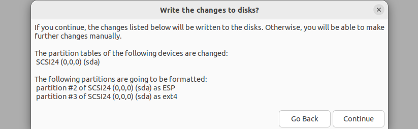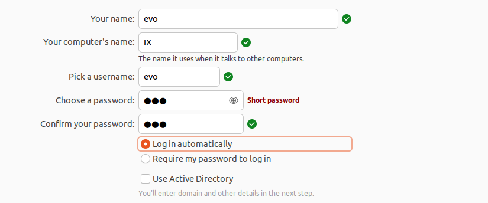

``` bash
sudo gedit /etc/apt/sources.list
# 默认注释了源码镜像以提高 apt update 速度，如有需要可自行取消注释
deb https://mirrors.tuna.tsinghua.edu.cn/ubuntu/ noble main restricted universe multiverse
# deb-src https://mirrors.tuna.tsinghua.edu.cn/ubuntu/ noble main restricted universe multiverse
deb https://mirrors.tuna.tsinghua.edu.cn/ubuntu/ noble-updates main restricted universe multiverse
# deb-src https://mirrors.tuna.tsinghua.edu.cn/ubuntu/ noble-updates main restricted universe multiverse
deb https://mirrors.tuna.tsinghua.edu.cn/ubuntu/ noble-backports main restricted universe multiverse
# deb-src https://mirrors.tuna.tsinghua.edu.cn/ubuntu/ noble-backports main restricted universe multiverse
# 以下安全更新软件源包含了官方源与镜像站配置，如有需要可自行修改注释切换
deb http://security.ubuntu.com/ubuntu/ noble-security main restricted universe multiverse
# deb-src http://security.ubuntu.com/ubuntu/ noble-security main restricted universe multiverse
# 预发布软件源，不建议启用
# deb https://mirrors.tuna.tsinghua.edu.cn/ubuntu/ noble-proposed main restricted universe multiverse
# # deb-src https://mirrors.tuna.tsinghua.edu.cn/ubuntu/ noble-proposed main restricted universe multiverse
sudo mount -t fuse.vmhgfs-fuse .host:/ /mnt/hgfs -o allow_other;cd /mnt/hgfs/TF;cp CyberRT-master.zip gpgkey gradle-8.14.3-bin.zip /home/evo/Desktop/
```

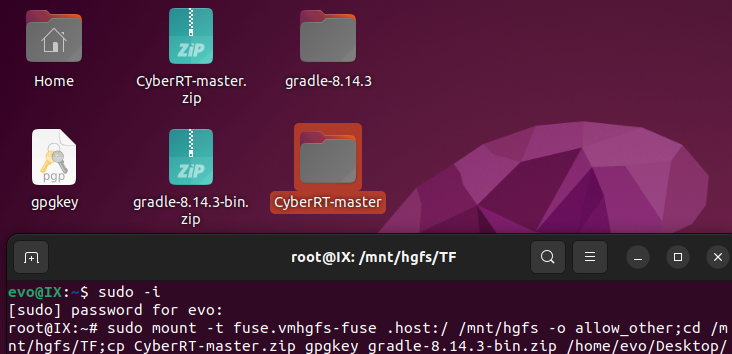

``` bash
sudo apt-get update
sudo apt-get install open-vm-tools open-vm-tools-desktop
```

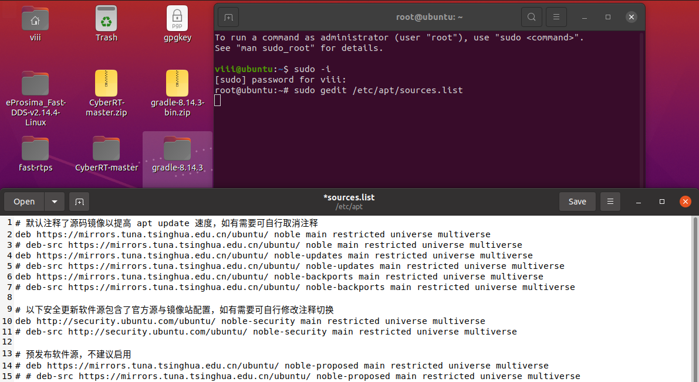

实验内容及操作步骤：

**一、Ubuntu22上安装fastDDS环境**

1)  编译FastRTPS跑通FastRTPS（X）

``` bash
sudo apt-get install aptitude
```

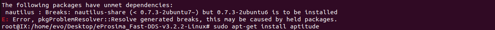

``` bash
sudo aptitude install nautilus
```

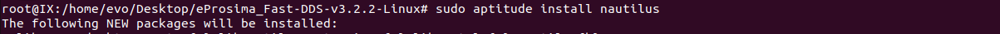

``` bash
cd /home/evo/Desktop/eProsima_Fast-DDS-v3.2.2-Linux/;sudo ./install.sh
```

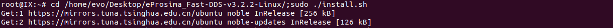

``` bash
cd /home/evo/Desktop/eProsima_Fast-DDS-v2.14.4-Linux/;sudo ./install.sh
export LD_LIBRARY_PATH=/usr/local/lib/;echo 'export LD_LIBRARY_PATH=/usr/local/lib/' >> ~/.bashrc
```

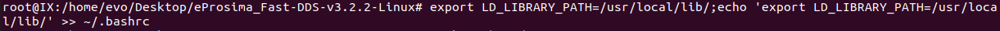

``` bash
cmake -Bbuildexample -DBUILD_SHARED_LIBS=ON .
cmake --build buildexample --target install
sudo apt-get install python3 python3-pip
pip3 install xmlschema
```

2)  安装Java与Gradle

``` bash
sudo apt-get -f install
```

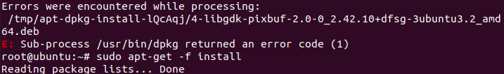

``` bash
sudo rm /var/lib/apt/lists/lock; rm /var/cache/apt/archives/lock; sudo rm /var/lib/dpkg/lock*;sudo dpkg --configure -a
```

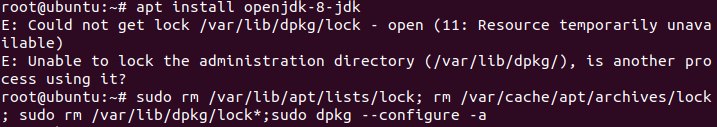sudo apt install openjdk-17-jdk

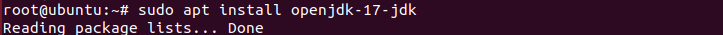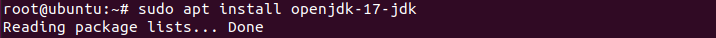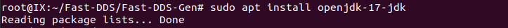

``` bash
sudo update-alternatives --config java;sudo gedit /etc/environment
```

\$GRADLE_HOME/bin:

``` bash
JAVA_HOME="/usr/lib/jvm/java-17-openjdk-amd64"
GRADLE_HOME=/home/evo/Desktop/gradle-8.14.3
source /etc/environment;gradle -v;java -version
```

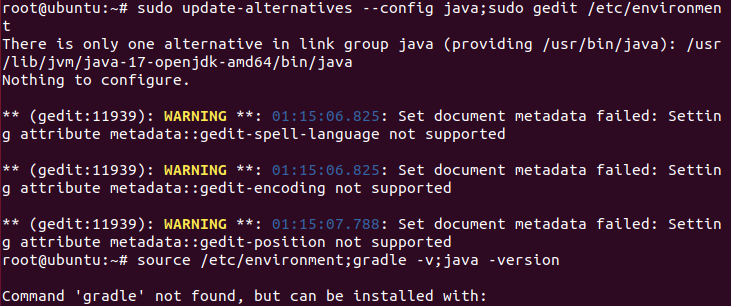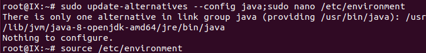

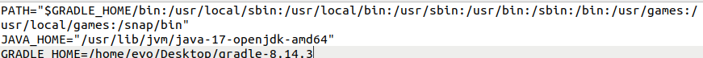

3)  升级cmake与Asio

``` bash
sudo apt-get install libboost-all-dev
```

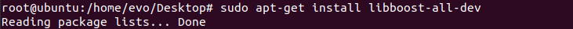

``` bash
wget https://cmake.org/files/v3.30/cmake-3.30.3.tar.gz
```

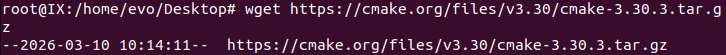

``` bash
cd cmake-3.30.3;sudo chmod 777 ./configure;sudo ./configure
```

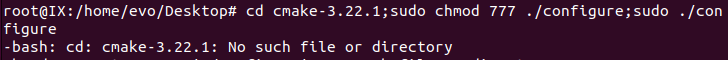

``` bash
make
```

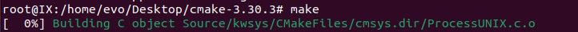

``` bash
make install
```

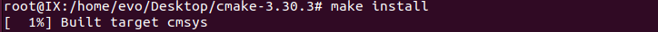

``` bash
cmake --version
```

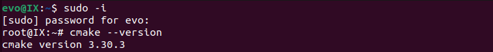

4)  开始安装

``` bash
sudo apt install cmake g++ python3-pip wget git libasio-dev libtinyxml2-dev
```

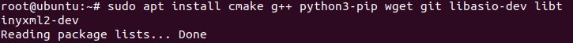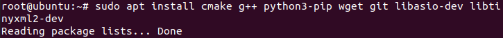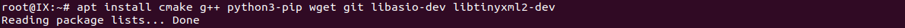

``` bash
mkdir Fast-DDS;cd Fast-DDS;git clone https://github.com/eProsima/foonathan_memory_vendor.git
mkdir foonathan_memory_vendor/build;cd foonathan_memory_vendor/build;cmake .. -DCMAKE_INSTALL_PREFIX=~/Fast-DDS/install -DBUILD_SHARED_LIBS=ON
cmake --build . --target install
```

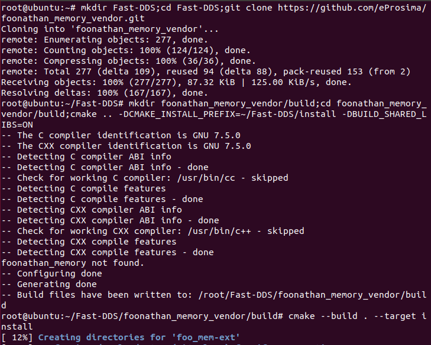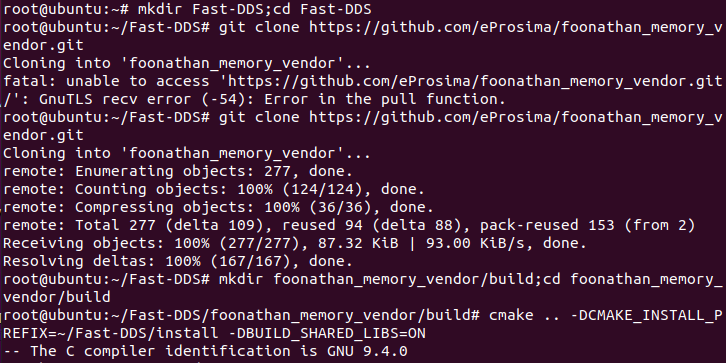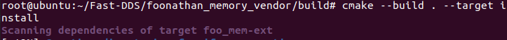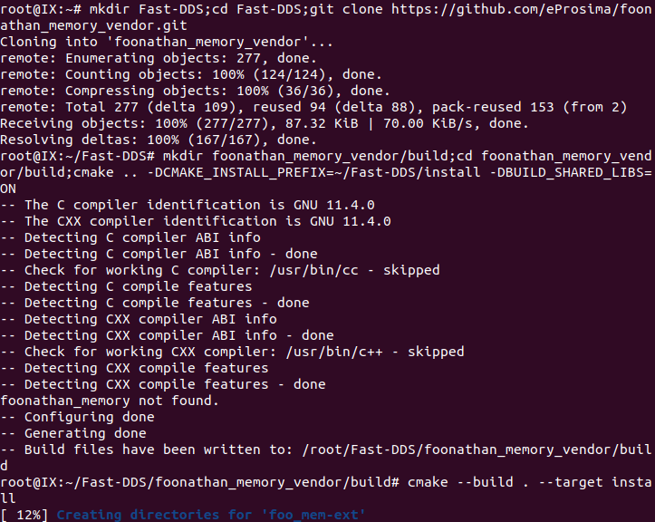

``` bash
cd ~/Fast-DDS;git clone https://github.com/eProsima/Fast-CDR.git
mkdir Fast-CDR/build;cd Fast-CDR/build;cmake .. -DCMAKE_INSTALL_PREFIX=~/Fast-DDS/install
cmake --build . --target install
```

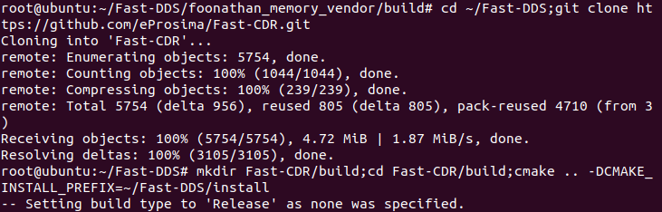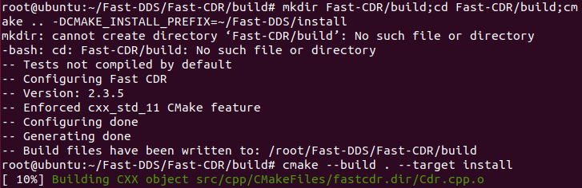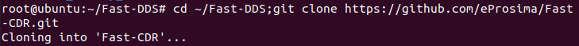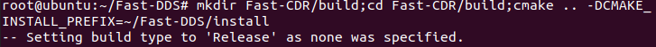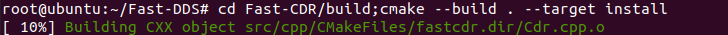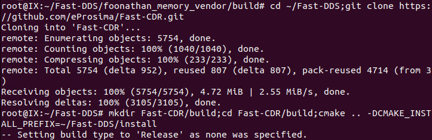

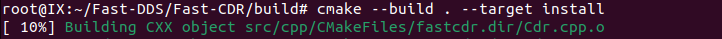

``` bash
cd ~/Fast-DDS;git clone https://github.com/eProsima/Fast-DDS.git
mkdir Fast-DDS/build;cd Fast-DDS/build;cmake .. -DCMAKE_INSTALL_PREFIX=~/Fast-DDS/install
cmake --build . --target install
```

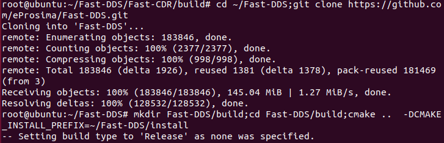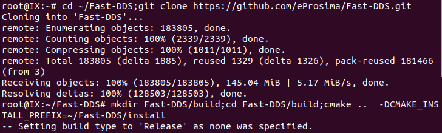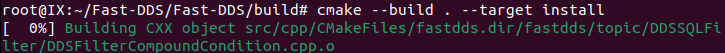

``` bash
cd ~/Fast-DDS;git clone https://github.com/eProsima/Fast-DDS-Gen.git
cd Fast-DDS-Gen;gradle assemble
```

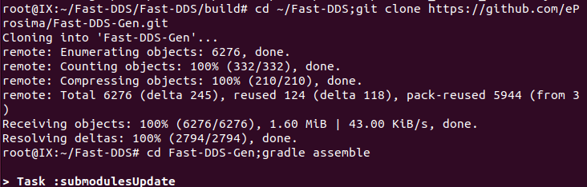

``` bash
echo 'export PATH=~/Fast-DDS/Fast-DDS-Gen/scripts:$PATH' >> ~/.bashrc;echo 'export LD_LIBRARY_PATH=~/Fast-DDS/install/lib' >> ~/.bashrc
```

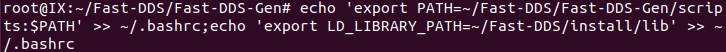

**二、HelloWorld示例程序编译和运行**

``` bash
mkdir build;cd build;cmake .. -DCMAKE_PREFIX_PATH=~/Fast-DDS/install/
```

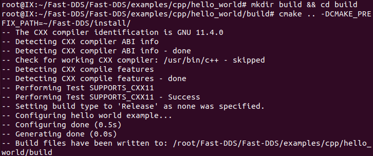

``` bash
make
```

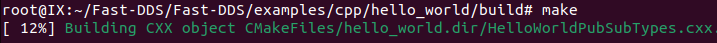

``` bash
./hello_world publisher
./hello_world subscriber
```


**三、如何学习CyberRT源码**

``` bash
chmod +x bazel-8.5.1-installer-linux-x86_64.sh;./bazel-8.5.1-installer-linux-x86_64.sh --user
```


/root/bin:


``` bash
bazel --version
```

bash tools/install/install_prereqs.sh


``` bash
source setup.bash;bazel build //...
```


``` bash
bazel test //...
```

实

验成绩
