实验教材：

[如何使用无影云电脑个人版-阿里云帮助中心](https://help.aliyun.com/zh/document_detail/2691751.html?spm=5176.29832386.J_xSdbmacXMmqE69pAttefy.d0_1.4c8d6b22UVGaWU&scm=20140722.M_10000012396.P_135.MO_3995-ID_10000012396-MID_10000012396-CID_0-ST_12084-PA_se@1018279723-V_1)

[Ubuntu安装vscode详细教程-CSDN博客](https://blog.csdn.net/DuanNaiLin/article/details/131803189?ops_request_misc=%7B%22request%5Fid%22%3A%222acadb2a27e4a343c43929fba0265720%22%2C%22scm%22%3A%2220140713.130102334.pc%5Fblog.%22%7D&request_id=2acadb2a27e4a343c43929fba0265720&biz_id=0&utm_medium=distribute.pc_search_result.none-task-blog-2~blog~first_rank_ecpm_v1~rank_v31_ecpm-5-131803189-null-null.nonecase&utm_term=ubuntu%E5%AE%89%E8%A3%85vscode&spm=1018.2226.3001.4450)

[Ubuntu \| Docker Docs](https://docs.docker.com/engine/install/ubuntu/#install-from-a-package)

实验环境：Delta

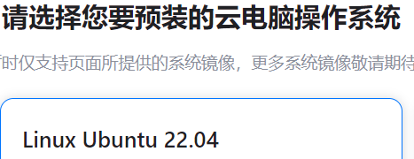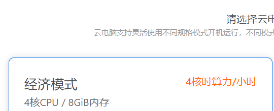

实验内容及操作步骤：

**一、安装VSCode**

``` bash
sudo dpkg -i code_1.111.0-1772846623_amd64.deb
```

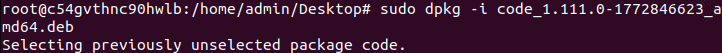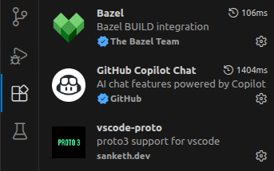

**二、6.0 hyper 8.0**

1)  安装Ubuntu Linux与Docker Engine

``` bash
sudo apt-get update
sudo apt-get upgrade
```

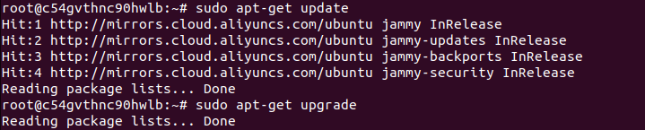

``` bash
sudo dpkg -i ./containerd.io_1.7.29-1~ubuntu.22.04~jammy_amd64.deb
./docker-ce-cli_28.5.2-1~ubuntu.22.04~jammy_amd64.deb
./docker-ce_28.5.2-1~ubuntu.22.04~jammy_amd64.deb
./docker-buildx-plugin_0.30.0-1~ubuntu.22.04~jammy_amd64.deb
./docker-compose-plugin_2.40.3-1~ubuntu.22.04~jammy_amd64.deb
```

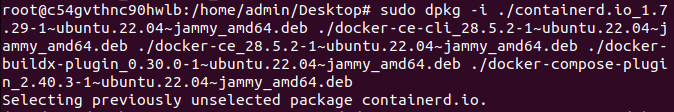

``` bash
sudo systemctl status docker
```

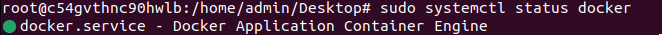

2)  安装 Apollo 环境管理工具

``` bash
sudo bash -c "echo 'deb https://apollo-pkg-beta.cdn.bcebos.com/neo/beta bionic main' >> /etc/apt/sources.list";wget -O - https://apollo-pkg-beta.cdn.bcebos.com/neo/beta/key/deb.gpg.key | sudo apt-key add -
```

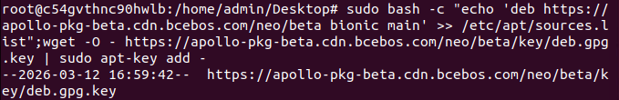sudo apt update

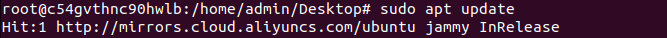

``` bash
sudo apt install apollo-neo-env-manager-dev
```

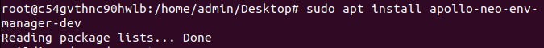

``` bash
aem -h
```

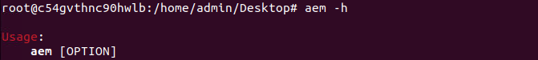

3)  创建和进入 Apollo 环境容器

``` bash
mkdir application-demo;cd application-demo;aem start
```

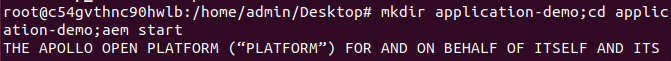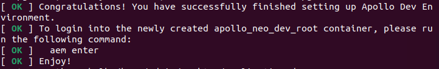

``` bash
aem enter
aem init
```

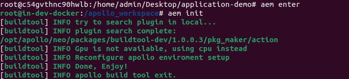

**三、源码安装**

``` bash
cd apollo-master/;bash docker/scripts/dev_start.sh
```

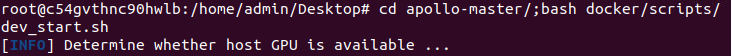

``` bash
bash docker/scripts/dev_into.sh;
./apollo.sh build
```

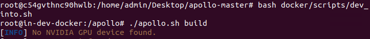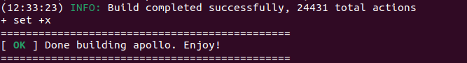

**四、使用CyberRecorder播放数据包、使用CyberMonitor查看Channel数据、使用CyberVisualizer查看原始感知数据**

1)  下载并解压数据包

``` bash
cd data;mkdir cyber_data;cd cyber_data;wget https://apollo-system.cdn.bcebos.com/dataset/6.0_edu/demo_sensor_data.tar.xz
tar -xvf demo_sensor_data.tar.xz
```

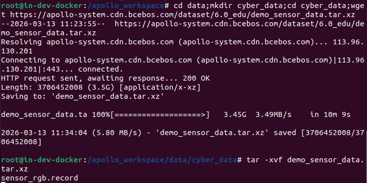

2)  播放数据包

``` bash
cyber_recorder play -f sensor_rgb.record -loop
```

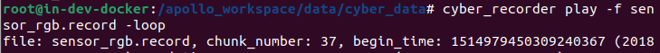

3)  查看 channel 数据

``` bash
cyber_monitor
```

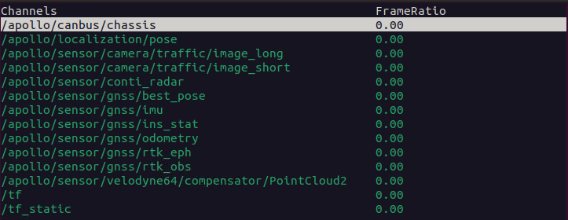

4)  运行Cyber_visualizer

``` bash
cyber_visualizer
```

实

验成绩
