实验教材：[第一章：Cyber RT基础入门与实践_Apollo开发者社区](https://apollo.baidu.com/community/article/1093)

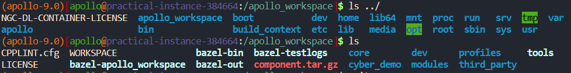

实验环境：Delta

``` bash
buildtool install cyber-dev
```


实验内容及操作步骤：

**一、Hello Apollo**

1)  创建本节实验工程目录

    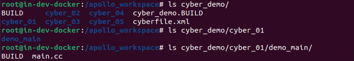

2)  编写包管理相关的BUILD和cyberfile.xml文件文件

    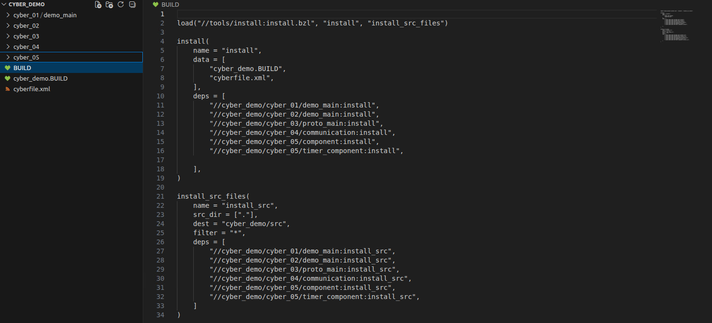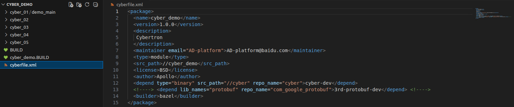

3)  编写源文件及BUILD文件

    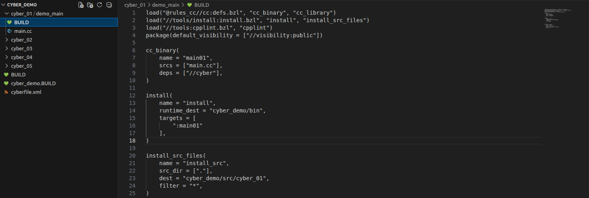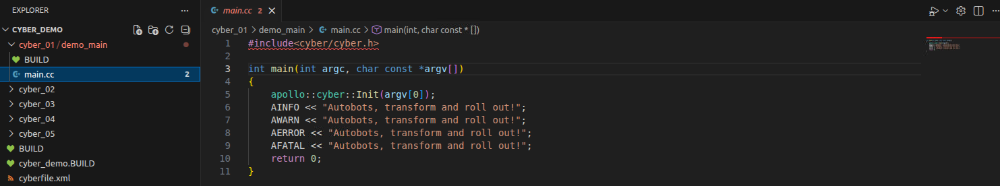

4)  编译代码目录

``` bash
buildtool build -p cyber_demo
```


5)  运行可执行文件

``` bash
cd /apollo_workspace/bazel-bin/cyber_demo/cyber_01/demo_main/;./main01
```

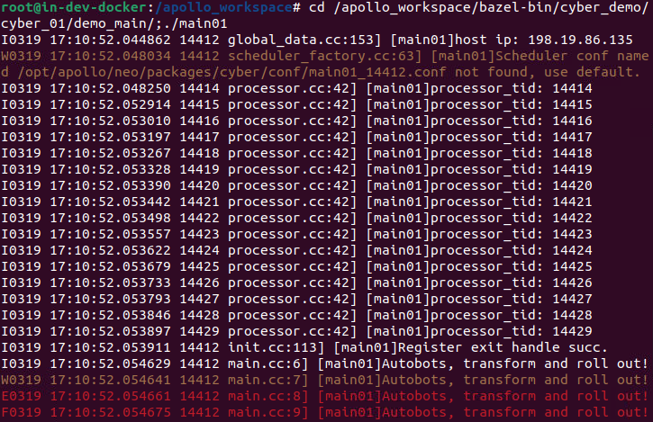

**二、构建多包工程**

1)  创建本节实验工程目录

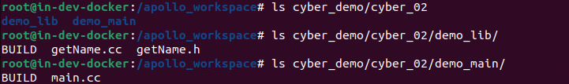

2)  编写源文件及BUILD文件

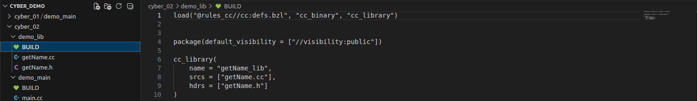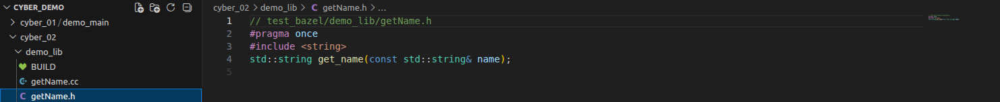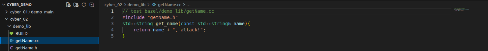

3)  编译代码目录

``` bash
buildtool build -p cyber_demo
```


4)  运行可执行文件

``` bash
cd /apollo_workspace/bazel-bin/cyber_demo/cyber_02/demo_main/;./main02
```

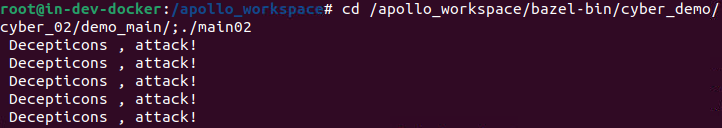

实

验成绩
