实验教材：[第二章：Cyber RT通信机制解析与实践_Apollo开发者社区](https://apollo.baidu.com/community/article/1094)

实验环境：Delta

实验内容及操作步骤：

**一、数据通信基础Protobuf**

1)  创建本节实验工程目录

    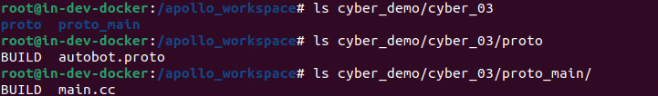

2)  编写proto文件及BUILD文件

    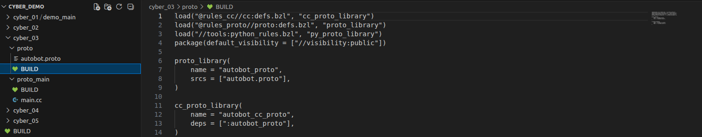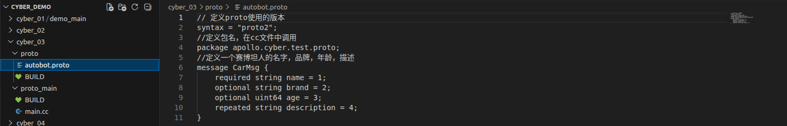

3)  编写主代码及BUILD文件

    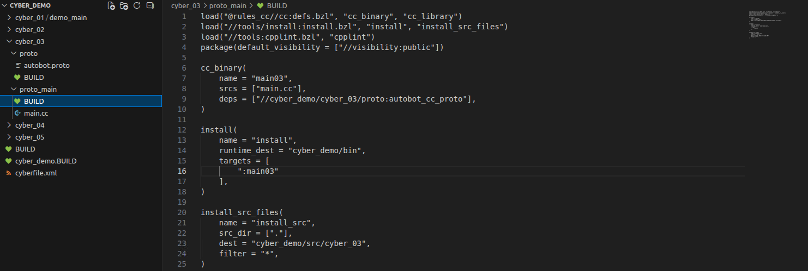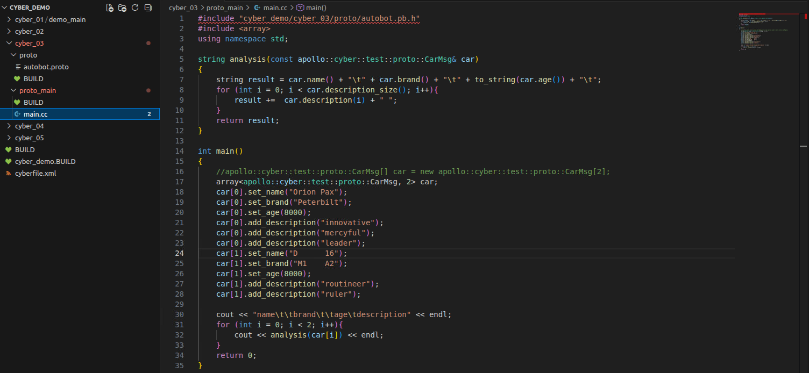

4)  编译代码目录

``` bash
buildtool build -p cyber_demo
```


5)  运行可执行文件

``` bash
cd /apollo_workspace/bazel-bin/cyber_demo/cyber_03/proto_main;./main03
```

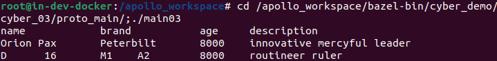

**二、Cyber RT通信机制解析与实践**

1)  创建本节实验工程目录

    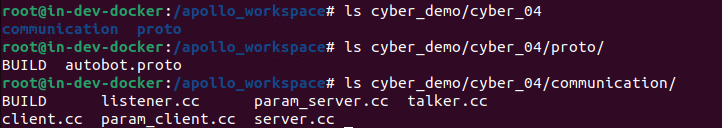

2)  proto文件编写

    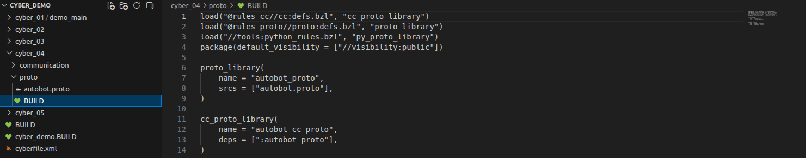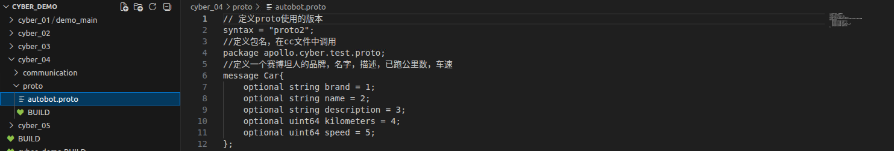

3)  talker.cc 文件编写

    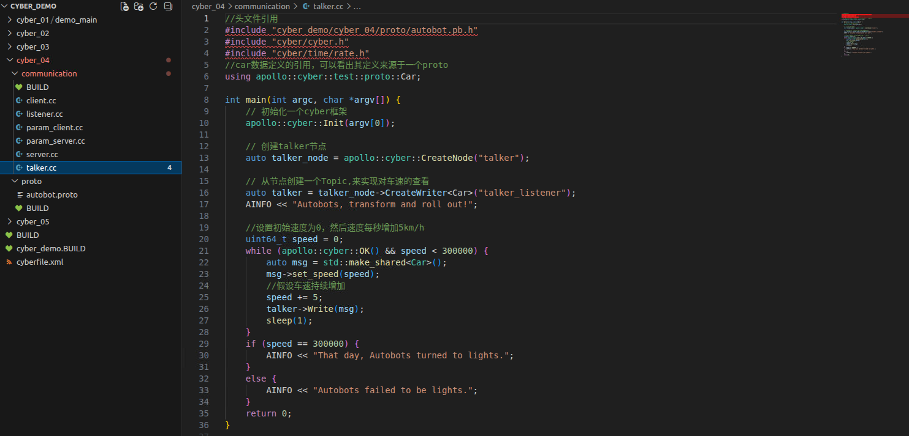

4)  listener.cc 文件编写

    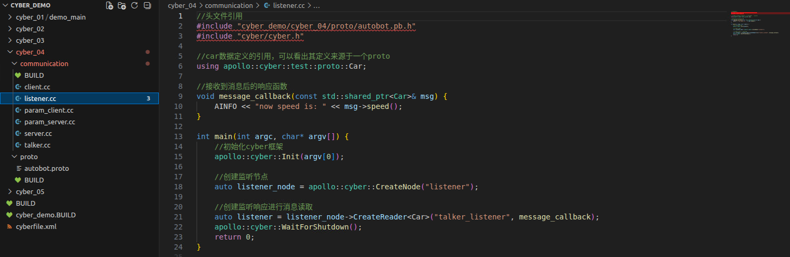

5)  bazel 编译文件编写

    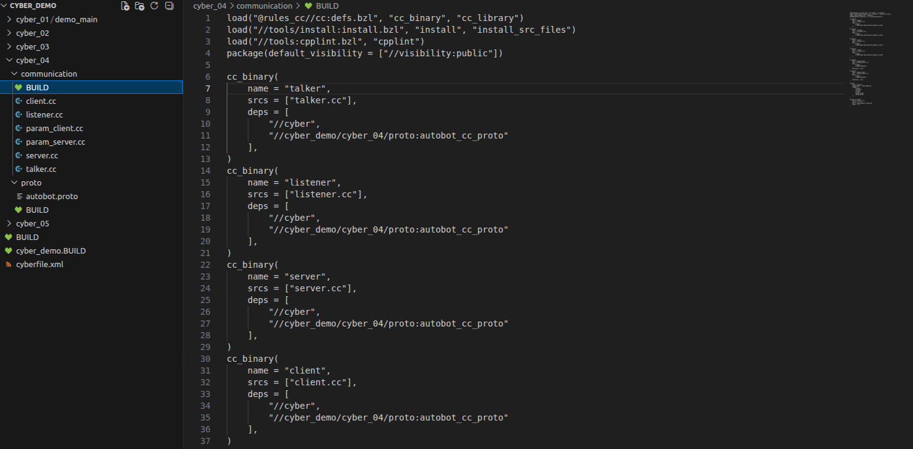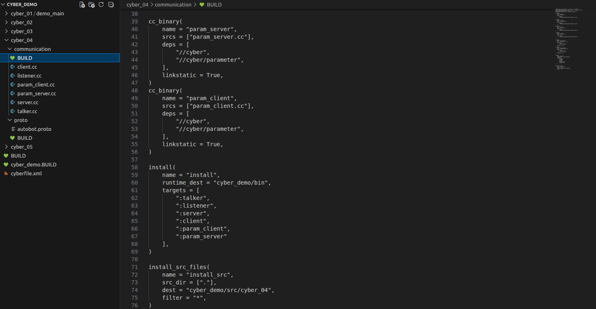

6)  编译

``` bash
buildtool build -p cyber_demo
```


``` bash
export GLOG_alsologtostderr=1
```

7)  运行案例

``` bash
./bazel-bin/cyber_demo/cyber_04/communication/talker
```

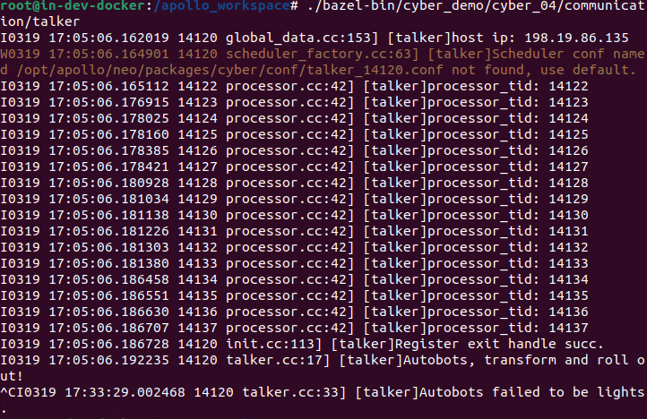

``` bash
./bazel-bin/cyber_demo/cyber_04/communication/listener
```

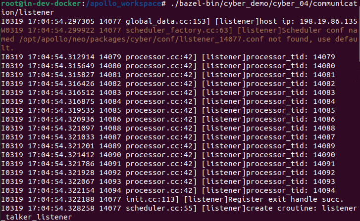

**三、实现小车详细信息的获取——Server-Client通信**

1)  server.cc 文件编写

    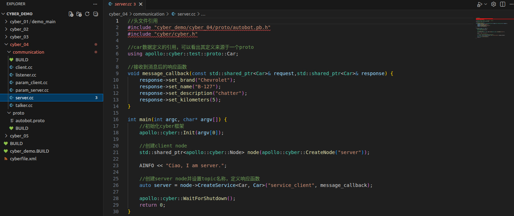

2)  client.cc 文件编写

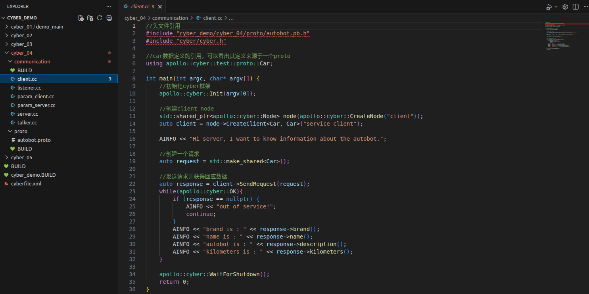

3)  编译

``` bash
buildtool build -p cyber_demo
```


``` bash
export GLOG_alsologtostderr=1
```

4)  运行案例

``` bash
./bazel-bin/cyber_demo/cyber_04/communication/server
```

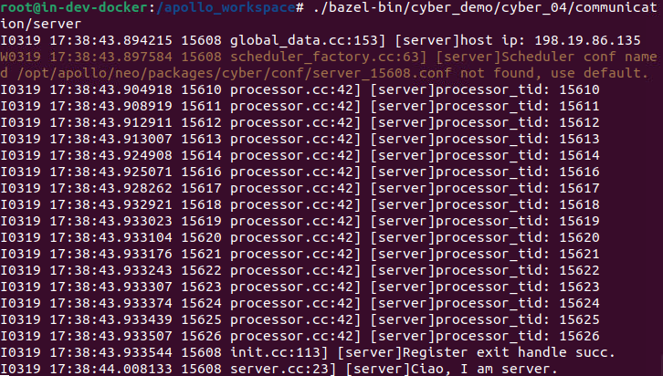

``` bash
./bazel-bin/cyber_demo/cyber_04/communication/client
```

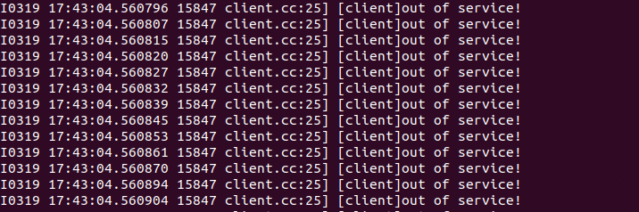

**四、 实现小车通用参数的设置——Parameter Server-Client**

1)  param_server.cc 文件编写

    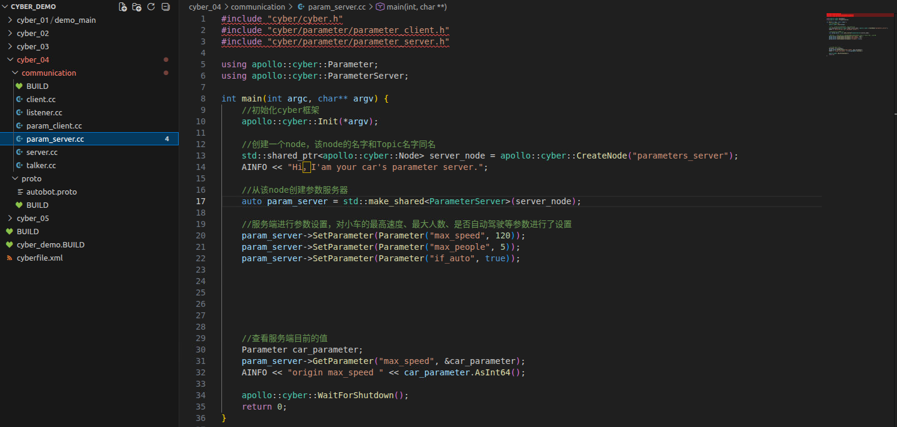

2)  param_client.cc 文件编写

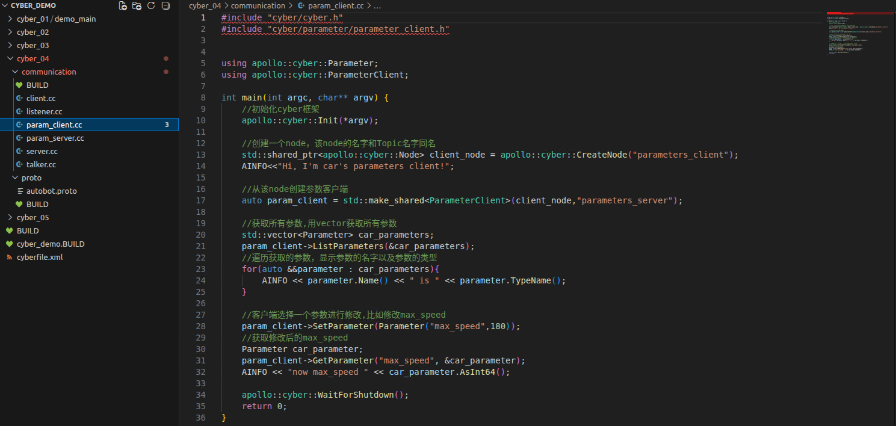

3)  编译

``` bash
buildtool build -p cyber_demo
```


``` bash
export GLOG_alsologtostderr=1
```

4)  运行案例

``` bash
./bazel-bin/cyber_demo/cyber_04/communication/param_server
```

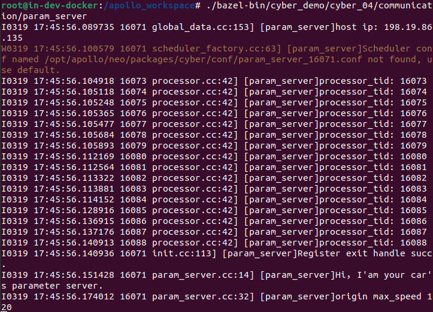

``` bash
./bazel-bin/cyber_demo/cyber_04/communication/param_client
```

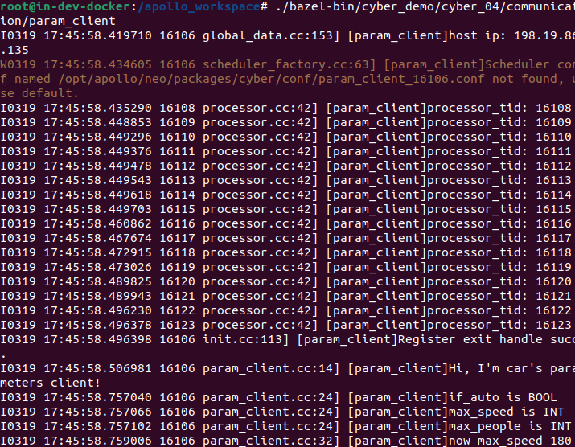

**五、录制Talker-Listener通信**

``` bash
cyber_recorder record -c talker_listener
```

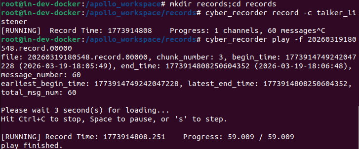

实

验成绩
