实验教材：[第三章：Component组件认知与实践_Apollo开发者社区](https://apollo.baidu.com/community/article/1103)

实验环境：Delta

实验内容及操作步骤：

**一、Component 案例**

1)  创建目录结构

    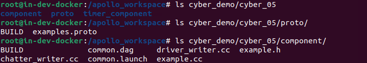

2)  定义消息格式

    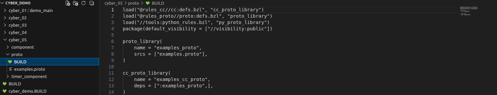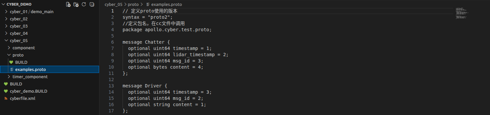

3)  writer 的实现

    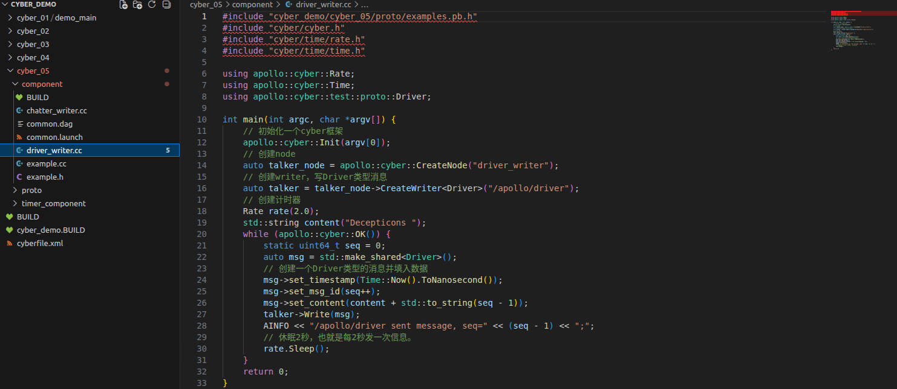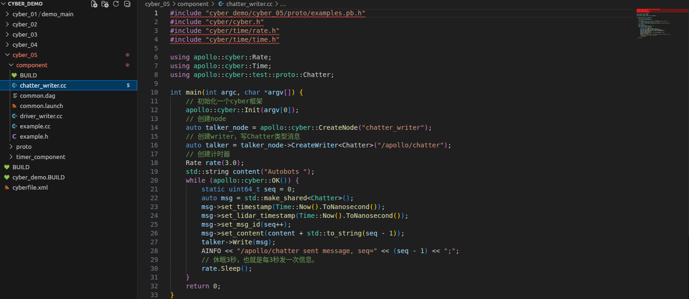

4)  Component 的实现

    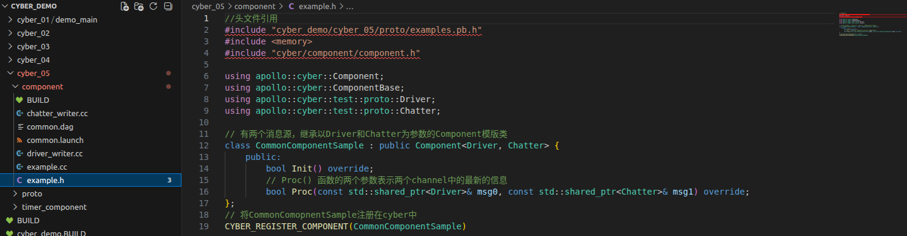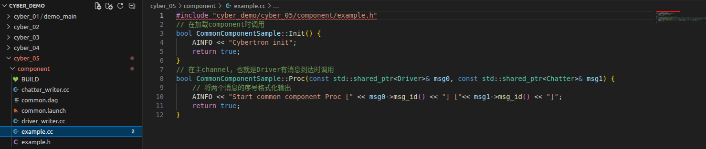

5)  配置文件

    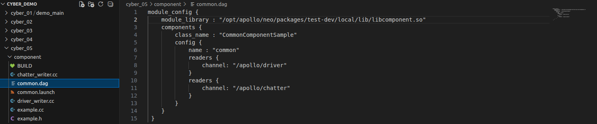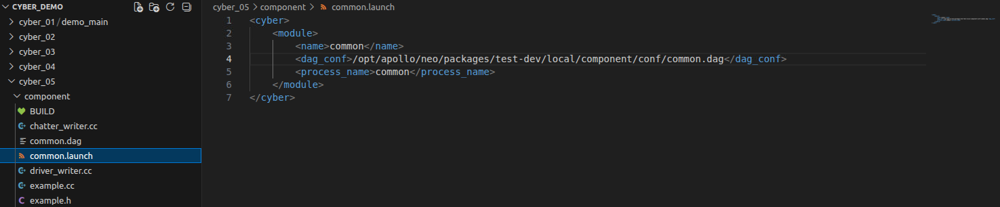

6)  编译文件

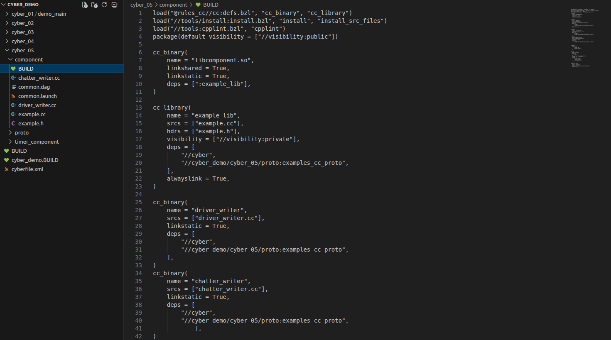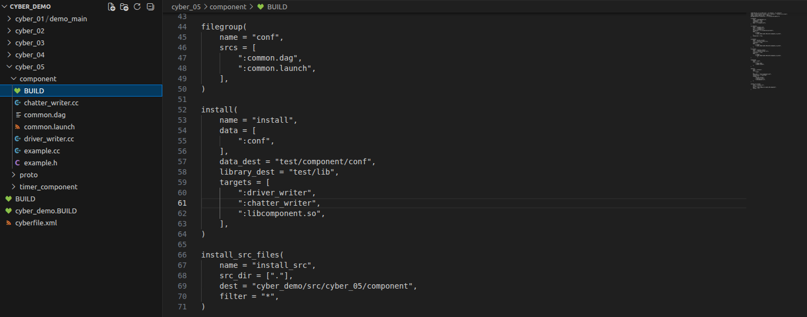

``` bash
buildtool build -p cyber_demo/
```

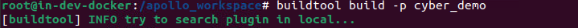

7)  运行

``` bash
./bazel-bin/cyber_demo/cyber_05/component/driver_writer
```

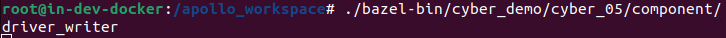

``` bash
./bazel-bin/cyber_demo/cyber_05/component/chatter_writer
```

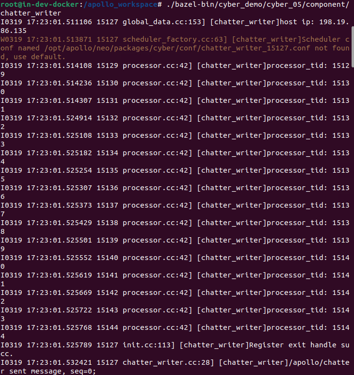

``` bash
export GLOG_alsologtostderr=1;cyber_launch start cyber_demo/cyber_05/component/common.launch
```

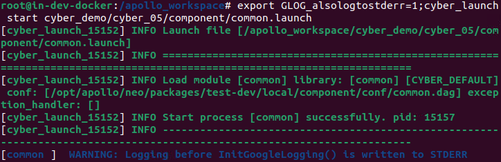

**二、TimerComponent 案例**

1)  创建目录

    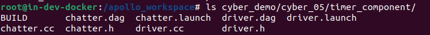

2)  TimerComponent 实现

    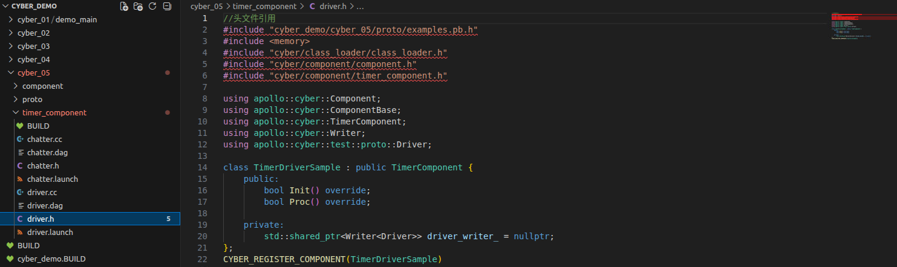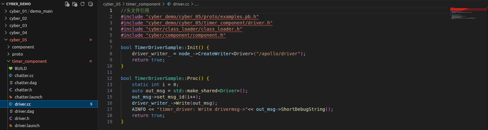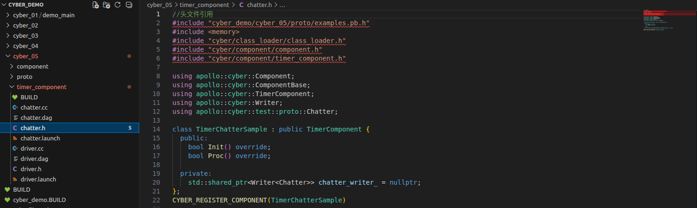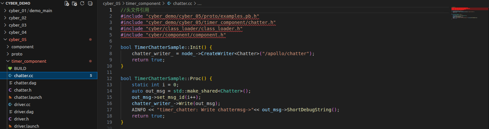

3)  配置文件

    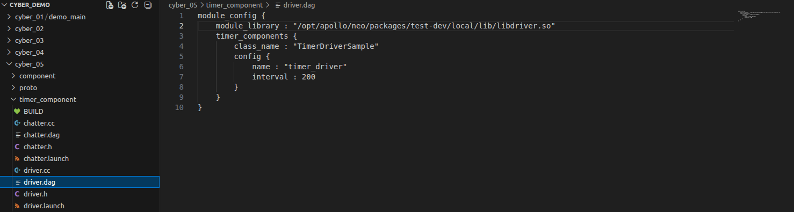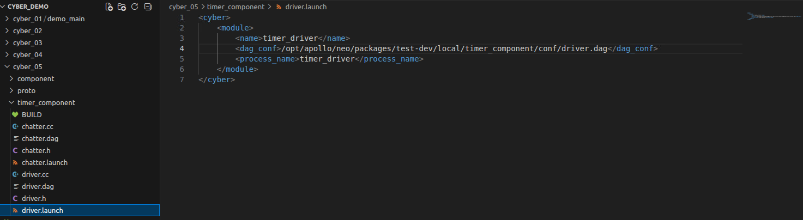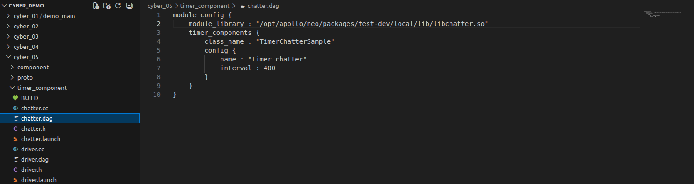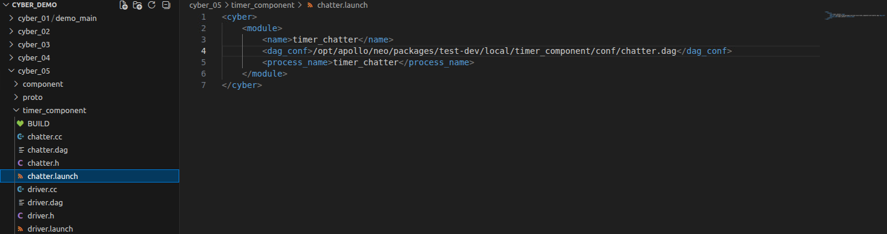

4)  编译文件

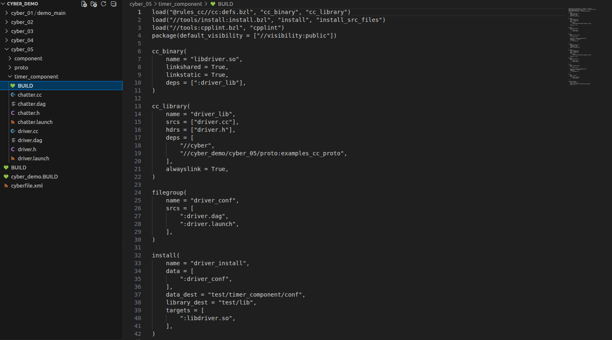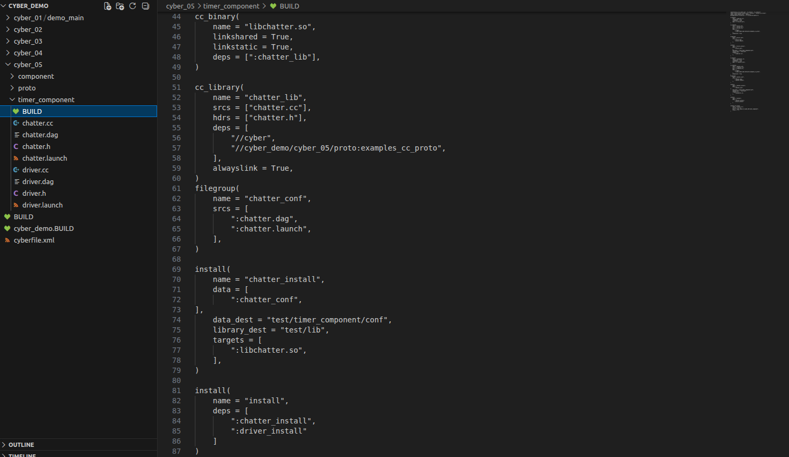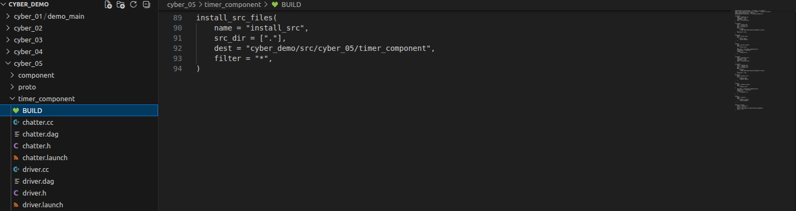

``` bash
buildtool build -p cyber_demo/
```


5)  运行

``` bash
cyber_launch start cyber_demo/cyber_05/component/common.launch
```


``` bash
cyber_launch start cyber_demo/cyber_05/timer_component/driver.launch
```

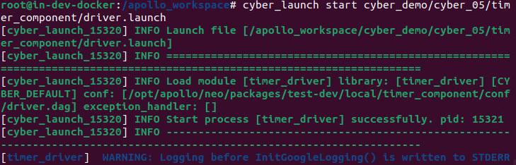

``` bash
cyber_launch start cyber_demo/cyber_05/timer_component/chatter.launch
```

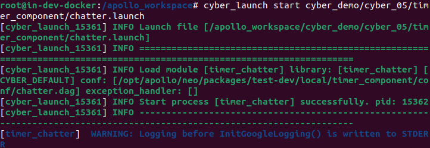

实

验成绩
