实验教材：[Ubuntu清理系统垃圾 命令-CSDN博客](https://blog.csdn.net/alex_sym/article/details/7671519?ops_request_misc=&request_id=&biz_id=102&utm_term=ubuntu%E6%B8%85%E7%90%86%E6%A0%B9%E7%9B%AE%E5%BD%95&utm_medium=distribute.pc_search_result.none-task-blog-2~blog~sobaiduweb~default-6-7671519.nonecase&spm=1018.2226.3001.4450)

[【export】Linux中export命令介绍，三种方法设置环境变量-CSDN博客](https://blog.csdn.net/Xminyang/article/details/125117111?ops_request_misc=%7B%22request%5Fid%22%3A%22ad87363eabe0774822621d55dab61bbd%22%2C%22scm%22%3A%2220140713.130102334..%22%7D&request_id=ad87363eabe0774822621d55dab61bbd&biz_id=0&utm_medium=distribute.pc_search_result.none-task-blog-2~blog~top_positive~default-1-125117111-null-null.nonecase&utm_term=export&spm=1018.2226.3001.4450)

实验环境：Delta

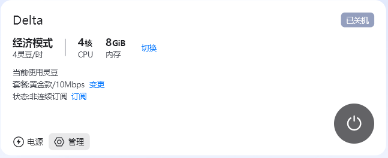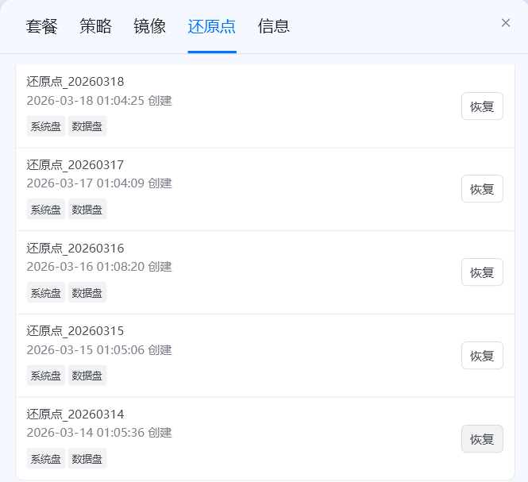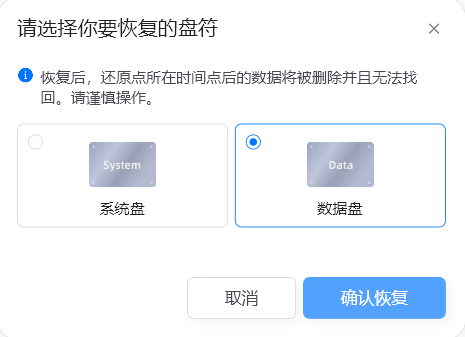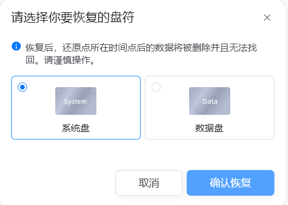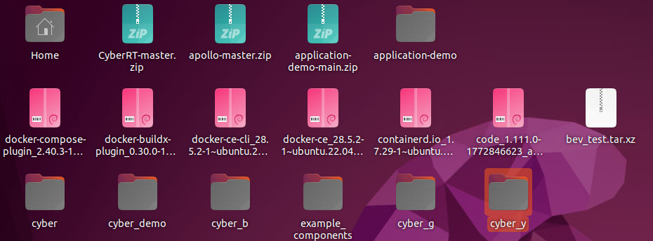

实验内容及操作步骤：

**一、清理与配置**

1)  清理

``` bash
echo > /var/log/syslog;echo > /var/log/kern.log;sudo apt-get autoclean;sudo apt-get clean;sudo apt-get autoremove
```

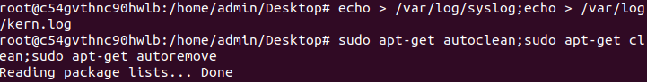

2)  配置

``` bash
vim /etc/profile
export GLOG_alsologtostderr=1;
source /etc/profile
```

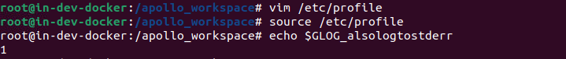

**二、修复**

1)  安装环节

``` bash
wget -O - https://apollo-pkg-beta.cdn.bcebos.com/neo/beta/key/deb.gpg.key | sudo apt-key add -
sudo apt update
```

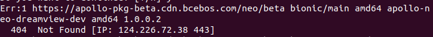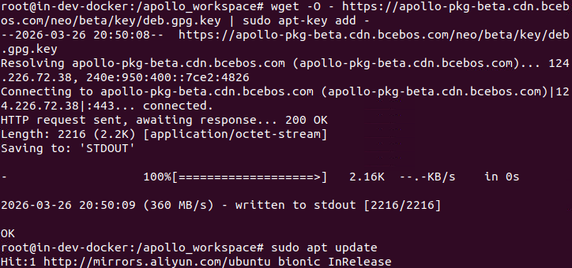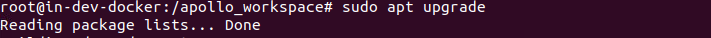

2)  编译环节

``` bash
cd /opt/apollo/neo/packages/bazel-extend-tools-dev;ls
mv 1.0.0.1/ 1.0.0.2
```

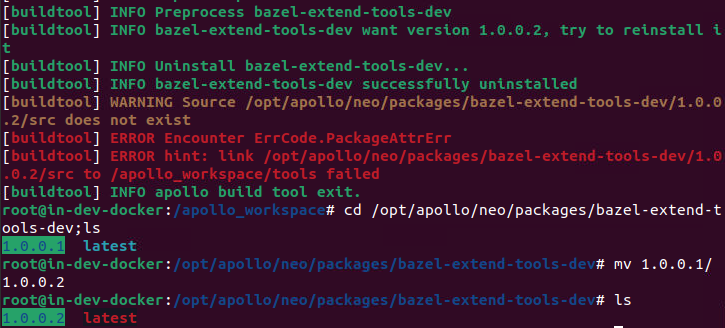cd /opt/apollo/neo/packages/cyber-dev;ls

``` bash
mv 1.0.0.1/ 1.0.0.3
```

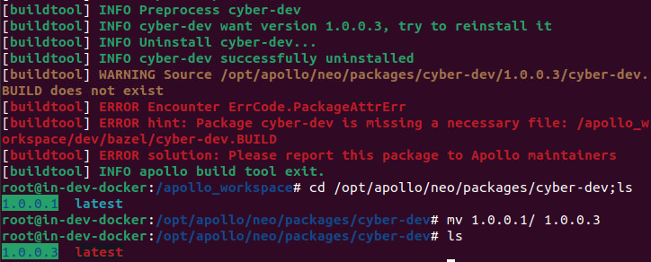buildtool build --packages cyber_demo

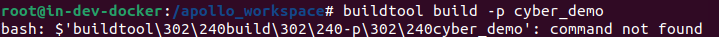

3)  执行环节

``` bash
mv cyber application-demo
cd /opt/apollo/neo/packages/
rm -r cyber
cd /apollo_workspace/
mv cyber /opt/apollo/neo/packages/
```

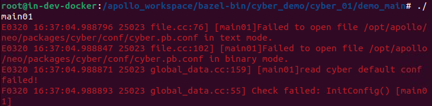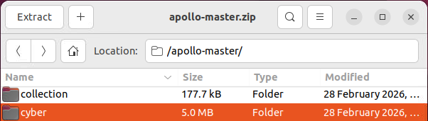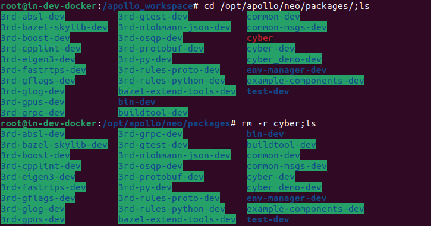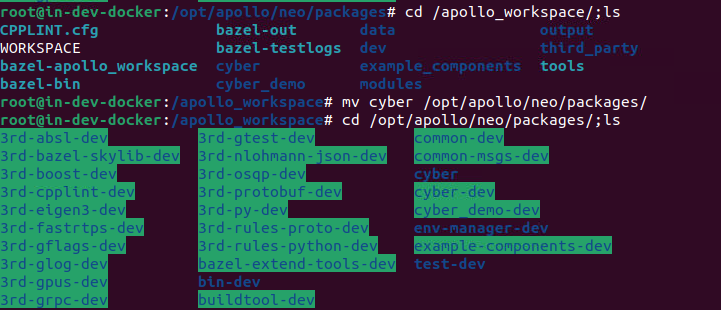

``` bash
cd /opt/apollo/neo/packages/cyber/conf/
vim cyber.pb.conf
```

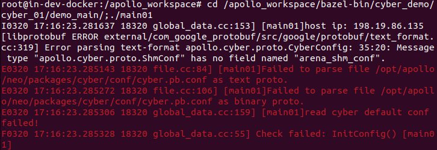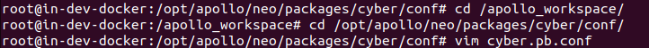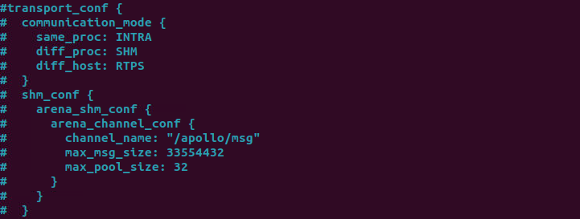

``` bash
buildtool reinstall cyber-dev
```

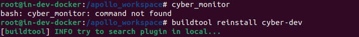

实

验成绩
