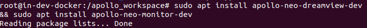
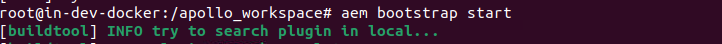
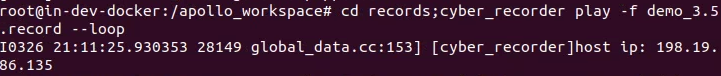
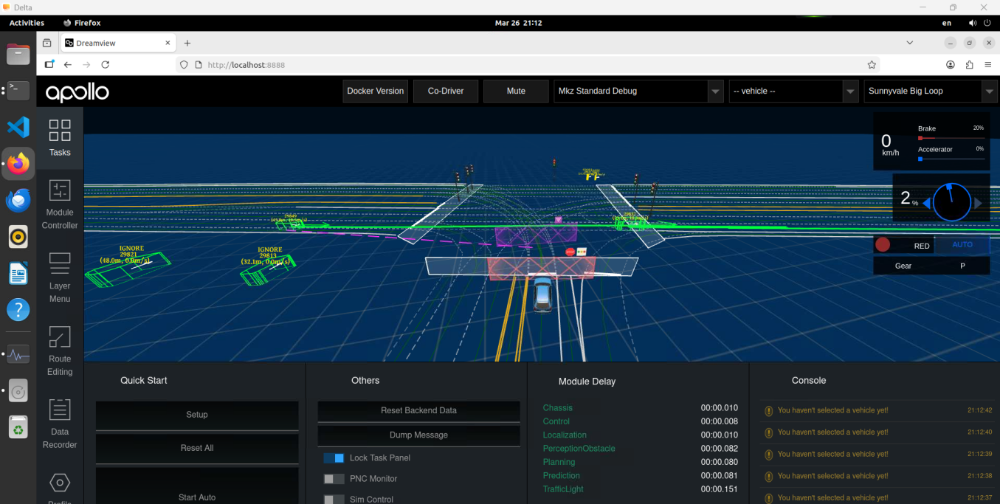
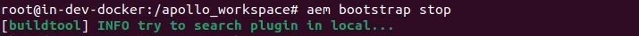
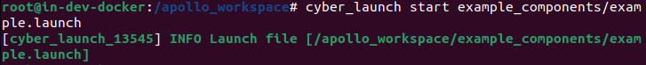
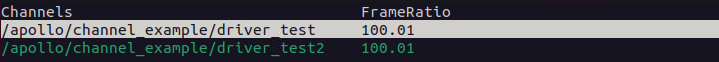

实验教材：[Dreaview](https://apollo.baidu.com/community/Apollo-Homepage-Document/Apollo_Doc_CN_8_0?doc=%2F%25E4%25BD%25BF%25E7%2594%25A8%25E6%258C%2587%25E5%258D%2597%2F%25E6%2595%25B4%25E4%25BD%2593%25E6%259E%25B6%25E6%259E%2584%2F%25E5%258F%25AF%25E8%25A7%2586%25E5%258C%2596)

[Apollo开放平台文档 - 必备软件安装指南](https://apollo.baidu.com/community/Apollo-Homepage-Document?doc=BYFxAcGcC4HpYIbgPYBtXIHQCMEEsATAV0wGNkBbWA5UyRFdZWATkwA9YKCB9GungCYe7AKIBWEQCEAgiJYAWEaIDs8pexkAOZZM2j5BsTvZS1pycLF6pAYRFaADLocAxeQEZlJqc-ZaAZh4EADZHcPEVSIQVEKiCAIRHFQQCFQAzFhCsxwBTXMFSTFAKVAB) 9.0

实验环境：Delta

实验内容及操作步骤：

**一、使用 Dreamview 查看数据包**

1)  安装并启动

``` bash
sudo apt install apollo-neo-dreamview-dev && sudo apt install apollo-neo-monitor-dev
```



``` bash
aem bootstrap start
```



2)  播放并查看

``` bash
cd records;cyber_recorder play -f demo_3.5.record --loop
```



http://localhost:8888



3)  停止 DreamView

``` bash
aem bootstrap stop
```



**二、Cyber 组件扩展**

``` bash
cyber_launch start example_components/example.launch
```



``` bash
cyber_monitor
```



实

验成绩
