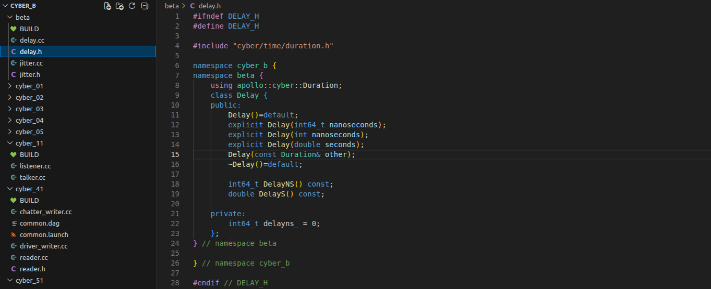
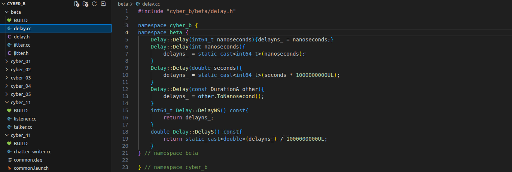
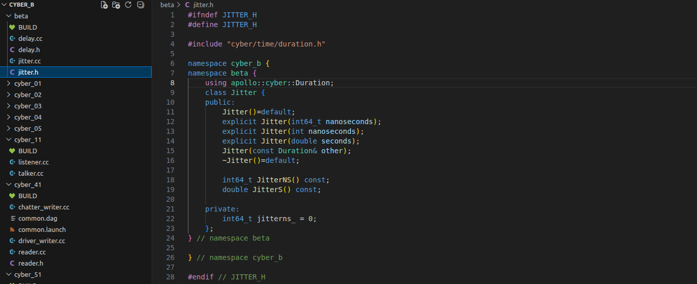
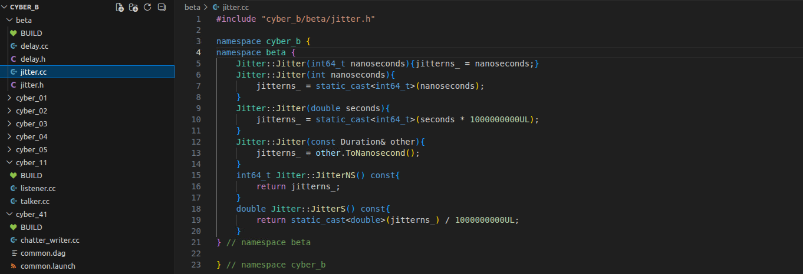
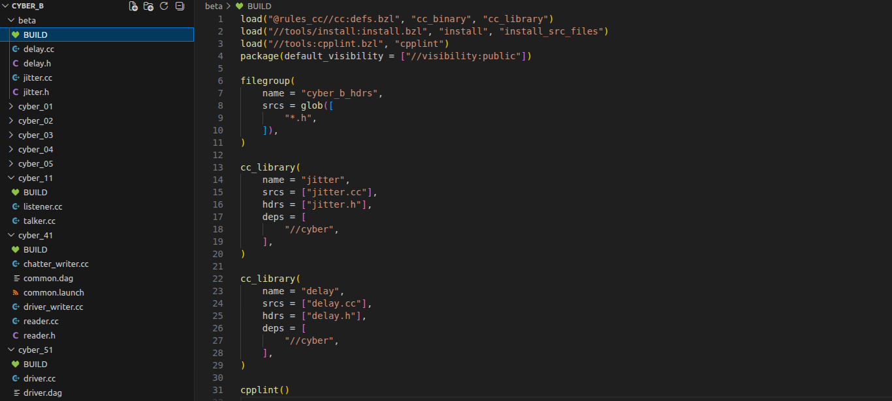
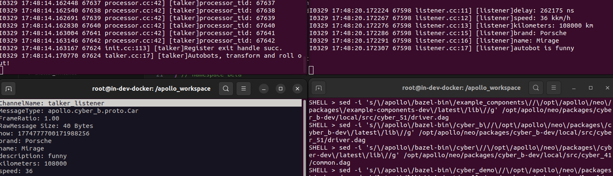
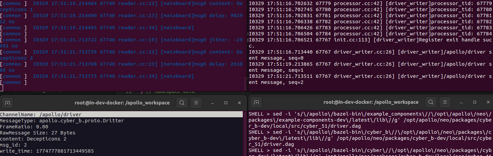
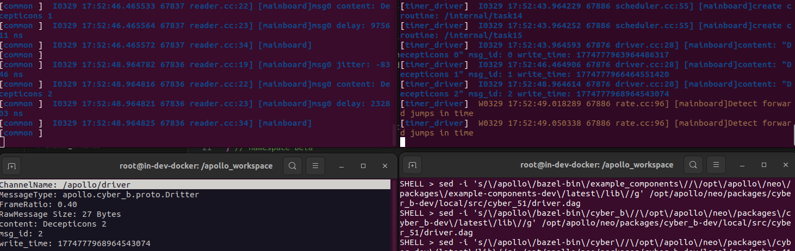

实验教材：Beta

实验环境：Delta

实验内容及操作步骤：

**一、指标定义**

1)  端到端时延



2)  周期抖动

    

3)  编译



**二、指标应用**

1)  端到端时延

``` bash
./bazel-bin/cyber_b/cyber_11/talker
```

./bazel-bin/cyber_b/cyber_11/listener

2)  端到端时延+周期抖动

``` bash
cyber_launch start cyber_b/cyber_41/common.launch
./bazel-bin/cyber_b/cyber_41/driver_writer
```



``` bash
cyber_launch start cyber_b/cyber_41/common.launch
cyber_launch start cyber_b/cyber_51/driver.launch
```



实

验成绩
