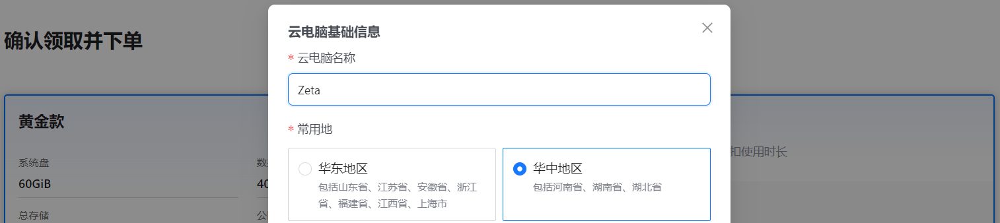
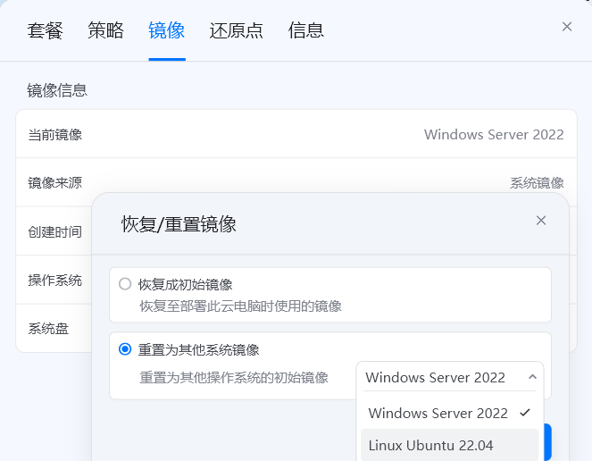
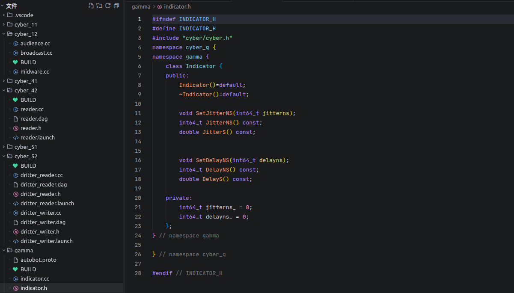
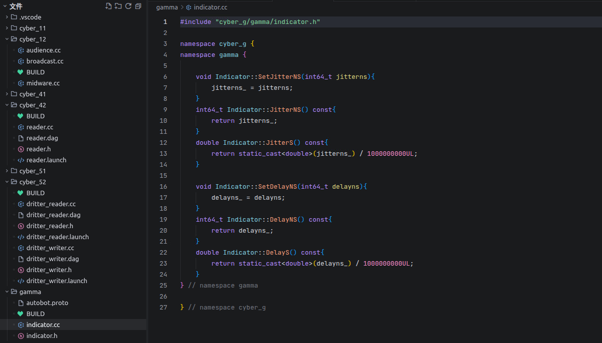
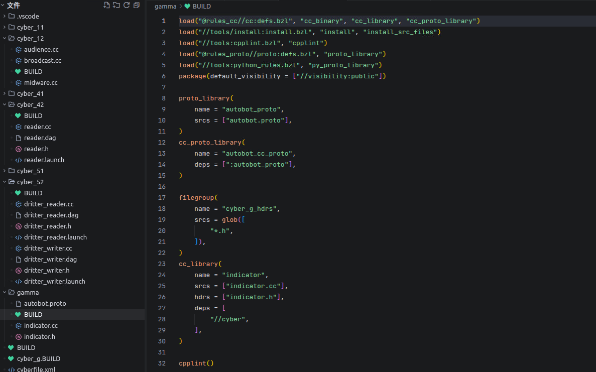
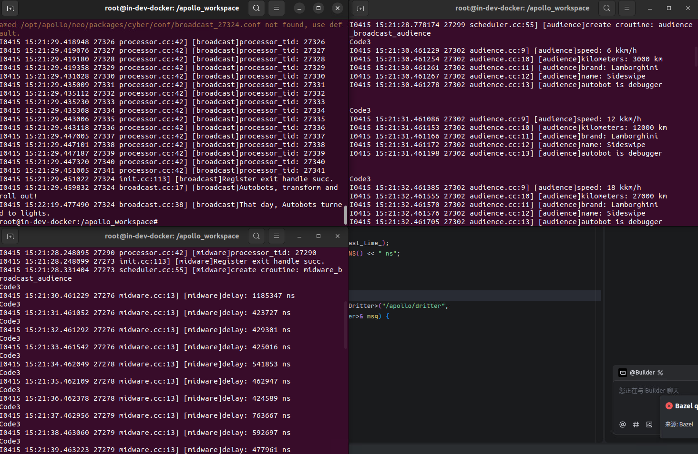
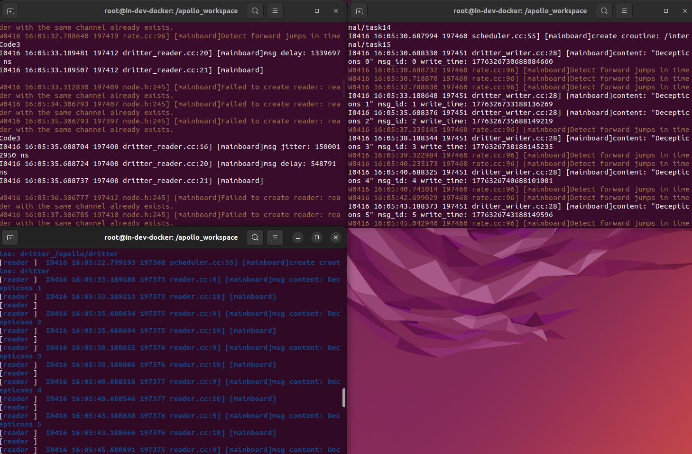

实验教材：Gamma

实验环境：Zeta



实验内容及操作步骤：

**一、指标体系定义**

1)  端到端时延



2)  编译



**二、指标体系应用**

1)  自主选择channel监听

``` bash
./bazel-bin/cyber_g/cyber_12/broadcast
./bazel-bin/cyber_g/cyber_12/audience
./bazel-bin/cyber_g/cyber_12/midware broadcast_audience
```



2)  通信监测数据解耦合

``` bash
cyber_launch start cyber_g/cyber_42/reader.launch
cyber_launch start cyber_g/cyber_52/dritter_reader.launch
cyber_launch start cyber_g/cyber_52/dritter_writer.launch
```



实

验成绩
