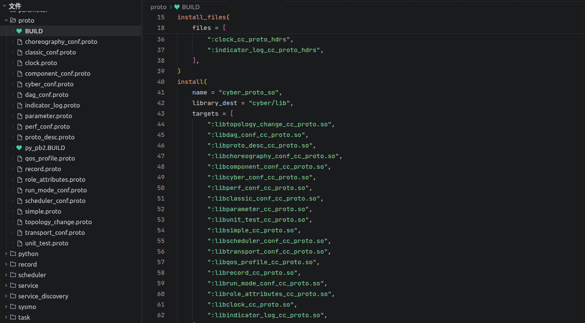
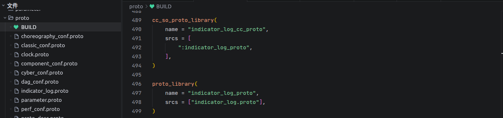
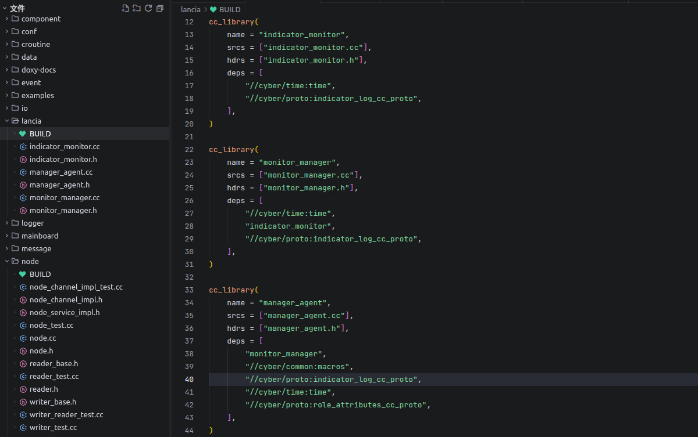
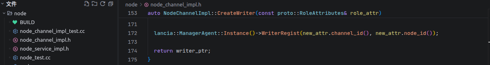
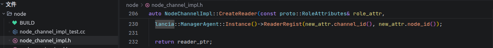
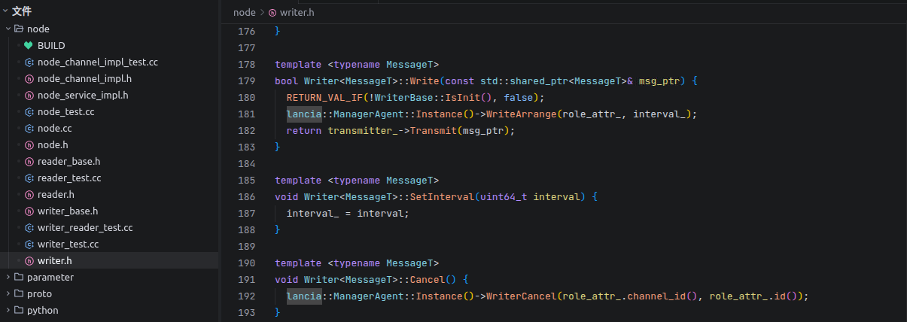
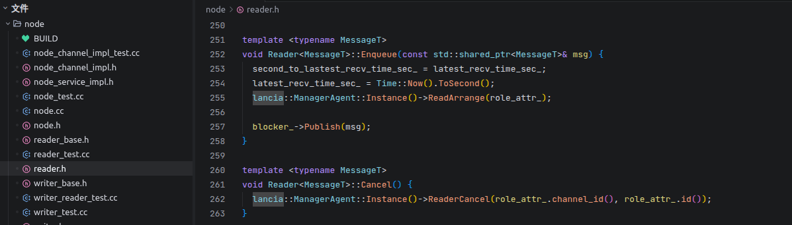
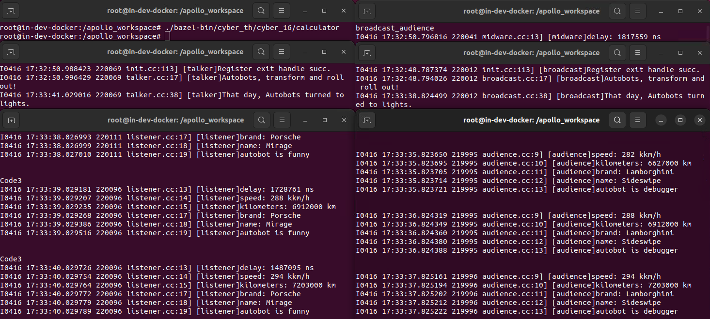
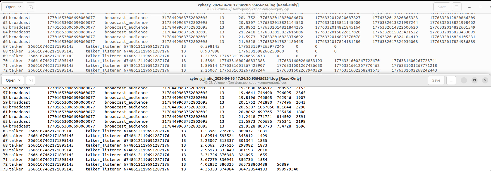

实验教材：Theta

实验环境：Zeta

实验内容及操作步骤：

**一、CyberRT埋点**

1)  指标日志编译



2)  埋点



**二、埋点应用**

1)  多channel、多节点并发监控

``` bash
./bazel-bin/cyber_th/cyber_16/broadcast
./bazel-bin/cyber_th/cyber_16/audience
./bazel-bin/cyber_th/cyber_16/talker
./bazel-bin/cyber_th/cyber_16/midware broadcast_audience
./bazel-bin/cyber_th/cyber_16/listener
./bazel-bin/cyber_th/cyber_16/calculator
```



2)  监控日志与指标日志



实

验成绩
